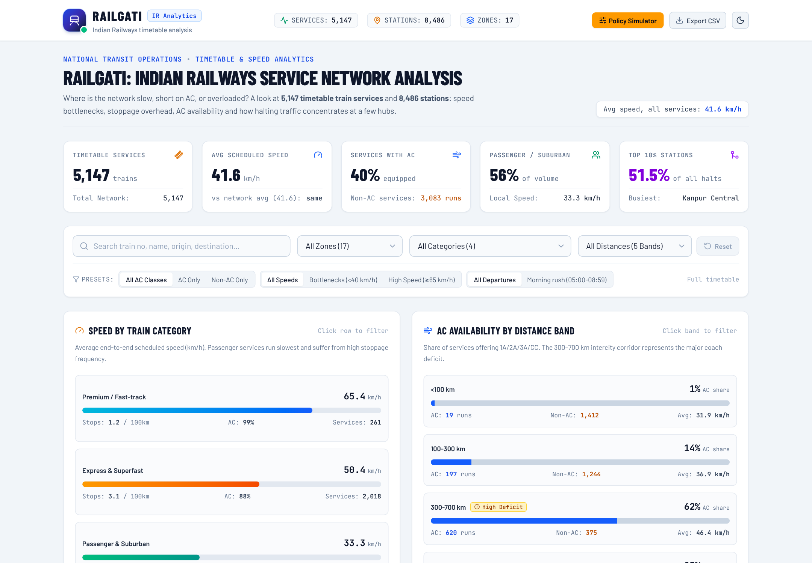
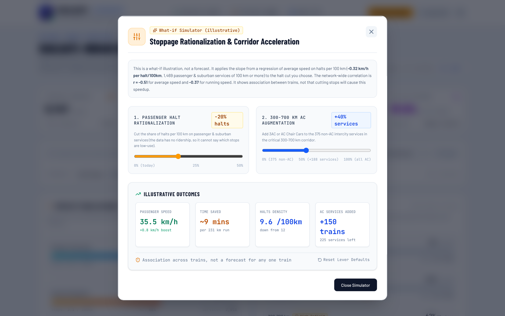

# Indian Railways Service Network Analysis



**[Live demo](https://indian-railways-analysis.vercel.app)** · Python · pandas · SQL (SQLite) · React · TypeScript · Tailwind · Data: [datameet/railways](https://github.com/datameet/railways) (CC0)

**Business question:** where is the Indian Railways passenger network slow, short on AC, or overloaded, and what should a planner look at first?

I cleaned the public timetable (5,147 train services, 8,486 stations), computed the KPIs in SQL, tested whether the main pattern survives a sanity check, and built an interactive dashboard on top. Every number in this README is re-checked against the data by `scripts/check_numbers.py` and in CI.

## Findings at a glance

| # | Finding | Evidence | Suggested first move |
|---|---------|----------|----------------------|
| 1 | Passenger & suburban trains are slow | 55.6% of services, 33.3 km/h average vs 50.4 km/h for express; 19.2 halts per 100 km vs 3.1. SECR (32.9 km/h), ECR (33.1) and NER (36.0) are the slowest zones, 68-75% passenger | Review stoppage patterns in those three zones |
| 2 | AC is missing on mid-distance routes | 375 of 995 services (38%) in the 300-700 km band have no AC, while 95-96% of services over 700 km do. Lowest AC share in the band: NER 31%, NWR 39%, WCR 41% | Add AC coaches on the busiest non-AC corridors there |
| 3 | A few stations take most of the halts | The busiest 10% of stations hold 51.5% of halting events; Kanpur Central (286) and Howrah Jn (283) lead. 30.3% of stations see 3 or fewer halting services | Check platform and pit-line capacity at the top hubs |
| 4 | Departures bunch in the morning | 25.6% of departures fall between 05:00 and 08:59, only 2.5% between 00:00 and 03:59 | Test the midday window for extra services (weakest evidence, see below) |

**How strong is each finding?** 1 is the strongest: it rests on 2,861 services and holds up after removing standing time and comparing within distance bands (below). 2 is a clear supply gap but depends on the AC definition in "Definitions and limits". 3 shows volume, not congestion, because the data has no platform or track capacity. 4 is the weakest: midday holds 3.5% of departures per hour against a 4.2% all-day average, and departure times are origin times, not station load.

### Is "more halts, lower speed" just arithmetic?
Average speed is distance divided by total time, and total time includes standing time, so some negative correlation is built in. `scripts/speed_vs_halts.py` checks it three ways:
- Standing time is 8.3% of all journey time. With it removed, running speed still falls as halts per 100 km rise (r = -0.37 overall, against a raw r = -0.51).
- Inside each distance band of 100 km and above, r runs from -0.31 to -0.72.
- Under 100 km the effect disappears (r = +0.19).

This is an association across trains. It does not prove that cutting one stop gives a fixed gain, which is why the dashboard's what-if simulator is labelled "illustrative".

## What is in this repo

| Part | What it shows |
|------|---------------|
| `scripts/clean.py` | pandas cleaning with rules per category, a documented reason for every dropped train (`data/excluded_trains.csv`) and a step-by-step log |
| `sql/queries.sql` | 7 KPI queries plus a drill-down: CTEs, `RANK` / `ROW_NUMBER` window functions, conditional aggregation, `HAVING` filters. Saved results in `sql/outputs/RESULTS.md` |
| `notebooks/01_eda_and_findings.ipynb` | EDA with charts and the speed-vs-halts check, runs on the committed CSVs |
| `dashboard-react/` | React + TypeScript + Tailwind dashboard: filters, drill-downs, a train explorer, a what-if simulator. All figures come from the pipeline, none are typed by hand |
| `scripts/check_numbers.py`, `.github/workflows/ci.yml` | Checks that README, notebook, dashboard data and SQL results agree with the CSVs; CI also re-runs the SQL, executes the notebook and builds the dashboard |
| `powerbi/` | DAX measures and a build guide (the `.pbix` is not built yet) |



## Data cleaning decisions

5,208 raw trains became 5,147 services. Nothing is dropped silently: `data/excluded_trains.csv` lists every train with its reason.

| Rule | Trains |
|------|--------|
| Missing or zero distance / duration | 42 trains without a valid distance or duration |
| Impossible speed for the category (above 140 km/h premium, 110 km/h other, 40 km/h narrow-gauge toy trains) | 9 trains, including 6 Matheran toy-train timetables listed at 126 km and 58-80 km/h |
| No usable stop times (arrival = departure at every stop, even origin and terminus) | 10 trains |

Other steps: missing railway zones (94 + 28 + 69 trains) are filled from the origin station, then the return train, then the destination station; 80 trains stay `Unknown` and are left out of zone rankings. The source mixes ALL CAPS and Title Case, so names are normalised. Stations keep their coordinates even when state and zone are missing in the source (Howrah, Kanpur Central and New Delhi have none), so 8,201 of 8,486 timetable stations, holding 99.3% of halting events, are geo-tagged.

## How to run
Needs Python 3.9+ and, for the dashboard, Node.js 20+.
```bash
python -m venv venv && source venv/bin/activate     # Windows: venv\Scripts\activate
pip install -r requirements.txt

python scripts/download_data.py      # 3 raw JSON files into raw/ (about 100 MB, pinned upstream commit)
python scripts/clean.py              # data/*.csv, excluded_trains.csv, cleaning_log.txt
python scripts/speed_vs_halts.py     # speed vs halts check -> data/speed_halts_check.csv
python sql/load.py                   # builds data/railways.db (SQLite)
python sql/run_queries.py            # saves query results to sql/outputs/
python scripts/build_dashboard.py    # refreshes dashboard-react/src/data/railwayData.ts
python scripts/check_numbers.py      # every line must say OK

cd dashboard-react
npm install
npm run dev                          # http://localhost:3000
npm run build                        # static site in dist/, any static host can serve it
```
The cleaned CSVs in `data/` are committed, so the notebook, SQL step, dashboard and Power BI guide work without the raw download. Only `data/schedules_clean.csv` (17 MB) is git-ignored; `clean.py` recreates it. For the notebook: `pip install -r requirements-notebook.txt`, then open `notebooks/01_eda_and_findings.ipynb`.

## Project structure
```
scripts/          download, clean, speed-vs-halts check, shared facts, dashboard feed, number checks
sql/              queries.sql + load.py + run_queries.py, results in outputs/
notebooks/        01_eda_and_findings.ipynb
data/             cleaned CSVs, excluded_trains.csv, cleaning_log.txt
dashboard-react/  React + TypeScript + Tailwind dashboard
powerbi/          DAX measures and build guide
docs/             screenshots used in this README
.github/          CI
```

## Definitions and limits
- **AC**: `has_ac = 1` if the train has 1A, 2A, 3A or chair car (CC). The datameet README does not define the `chair_car` flag; this assumes it means AC Chair Car, as CC does in Indian Railways class codes. Second sitting (2S) is non-AC and is not counted. Shatabdi is 100% chair car, so leaving CC out would wrongly mark Shatabdi as non-AC.
- **Halts**: a stop where arrival and departure differ. A train's origin (no arrival time) and terminus (no departure time) count as halts, which adds 2 halts per train: 12.0 halts per 100 km on average with them, 9.9 without. Station-level halting counts keep these events, since trains do stop there.
- **Speed vs halts**: see the check above. Results are in `data/speed_halts_check.csv`.
- **What-if simulator**: an illustration, not a forecast. Its only inputs are measured from this data: the slope of average speed on halts per 100 km for passenger & suburban services of 100 km or more (about -0.32 km/h per halt per 100 km, 1,469 services) and their average speed, halts and distance. "Est. standing time" in the train detail view is intermediate halts x the average dwell per halt measured from the schedules (about 3.1 min).
- **Supply, not demand**: no running days, ridership or revenue in the data, so a service is not a daily train and the figures show what is scheduled, not what is used.
- **Categories**: `Heritage / Toy` holds the 7 narrow-gauge toy trains that passed the speed check. The Nilgiri and Darjeeling hill services typed as Passenger stay in Passenger & Suburban. Hyderabad MMTS, Delhi and Kolkata suburban types are counted as Passenger & Suburban.
- **Source quality**: the datameet data is a community-collected snapshot that looks several years old, so findings describe that timetable, not today's network. Some distances in the source are probably wrong in ways no rule can detect without outside data.

## License
Code: MIT (see `LICENSE`). Data: datameet/railways, CC0.
